# lmcad

**Parametric 3D solids from lmscript: OpenCASCADE B-rep modelling, volume checks, and a built-in software renderer that writes PNG, APNG and STL with no GPU or display.**

[](https://github.com/lmctl-ai/lmcad/actions/workflows/ci.yml)
[](https://github.com/lmctl-ai/lmcad/releases)
[](LICENSE)

### Machine design

| Spur gears, 2:1 reduction | Compression spring, free vs 200 N | Air receiver cutaway |
| --- | --- | --- |
| 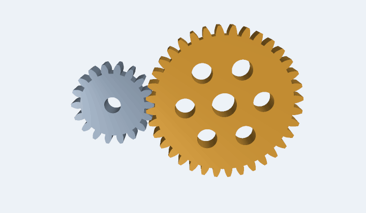 | 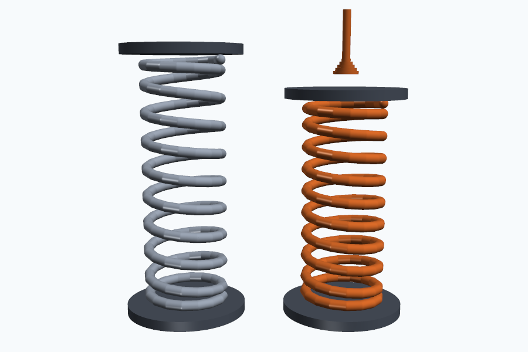 | 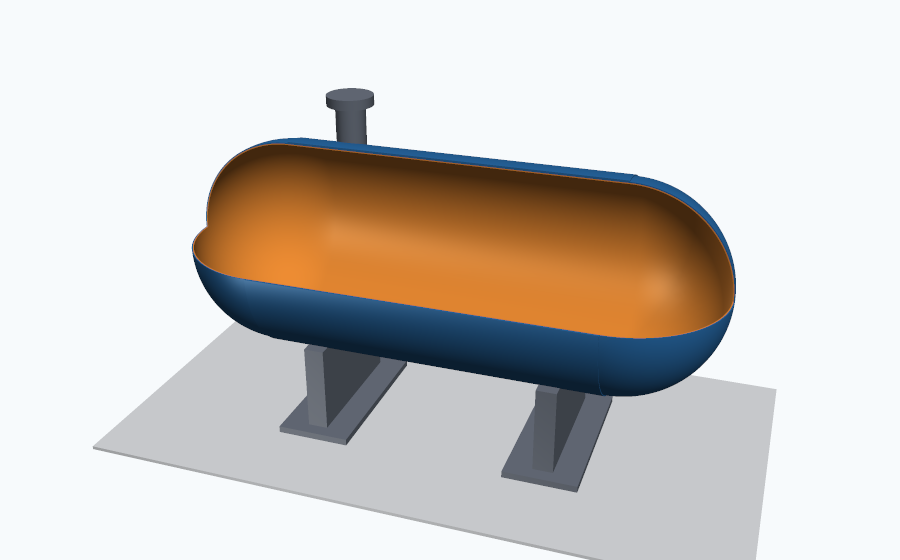 |
| True involute teeth mesh at a = m(z1+z2)/2 = 54 mm<br>`lmctl autorun https://raw.githubusercontent.com/lmctl-ai/lmcad/main/examples/gear-train.lms` | Rate k = Gd⁴/8D³n = 11.75 N/mm, so 200 N shortens it 17 mm<br>`lmctl autorun https://raw.githubusercontent.com/lmctl-ai/lmcad/main/examples/coil-spring.lms` | ASME wall sizing: 6.6 mm shell, 3.3 mm heads, 396 L checked on the B-rep<br>`lmctl autorun https://raw.githubusercontent.com/lmctl-ai/lmcad/main/examples/pressure-vessel.lms` |

### Structures

| Pratt truss footbridge | Same steel, four beam shapes | Plate with eight bores |
| --- | --- | --- |
| 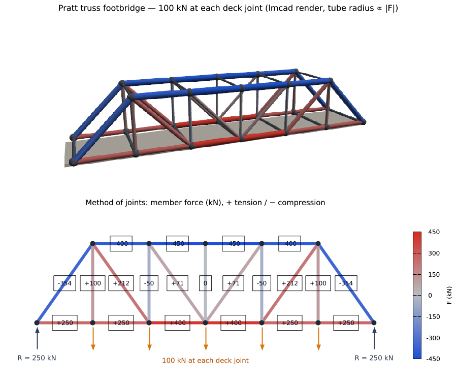 | 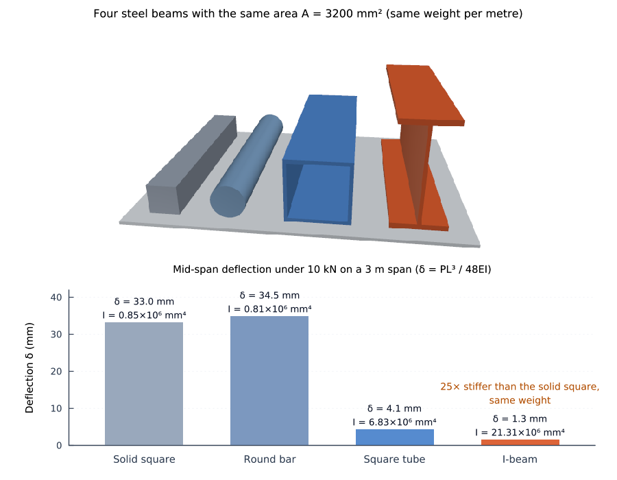 | 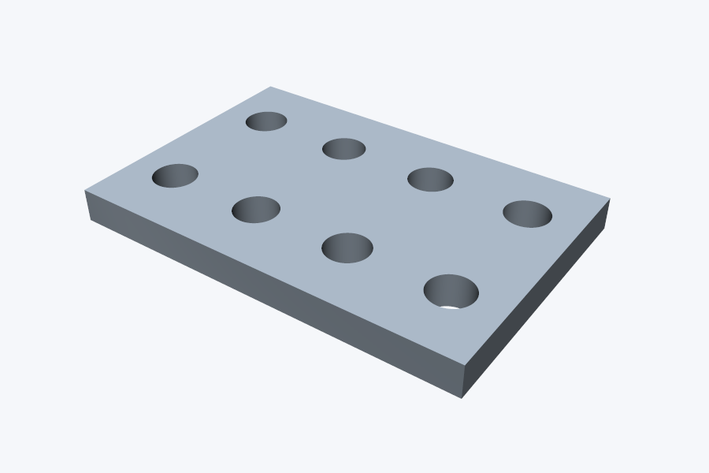 |
| Method of joints: red tension, blue compression, mid top chord −450 kN<br>`lmctl autorun https://raw.githubusercontent.com/lmctl-ai/lmcad/main/examples/truss-bridge.lms` | Equal area, but the I-beam deflects 25× less than a solid square<br>`lmctl autorun https://raw.githubusercontent.com/lmctl-ai/lmcad/main/examples/beam-sections.lms` | Boolean cuts; the B-rep volume gives 230.5 g of aluminium, 11 % lighter<br>`lmctl autorun https://raw.githubusercontent.com/lmctl-ai/lmcad/main/examples/plate-with-holes.lms` |

### Heat, fields and molecules

| How many heat-sink fins? | Electric dipole field | Buckminsterfullerene C60 |
| --- | --- | --- |
| 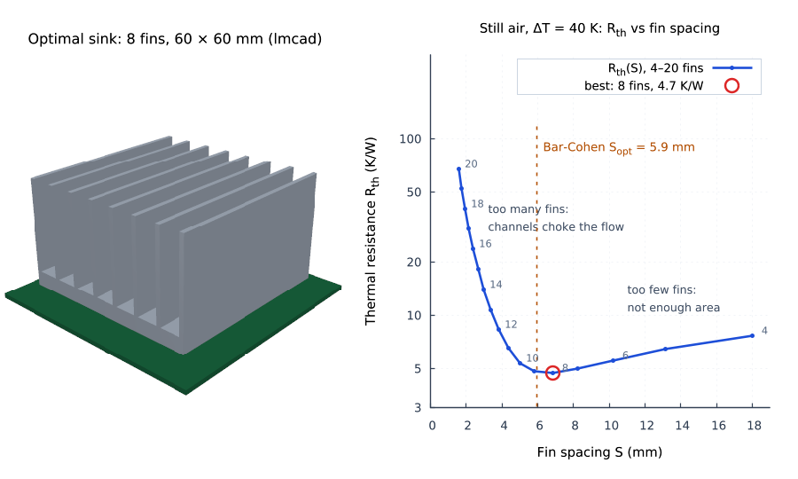 | 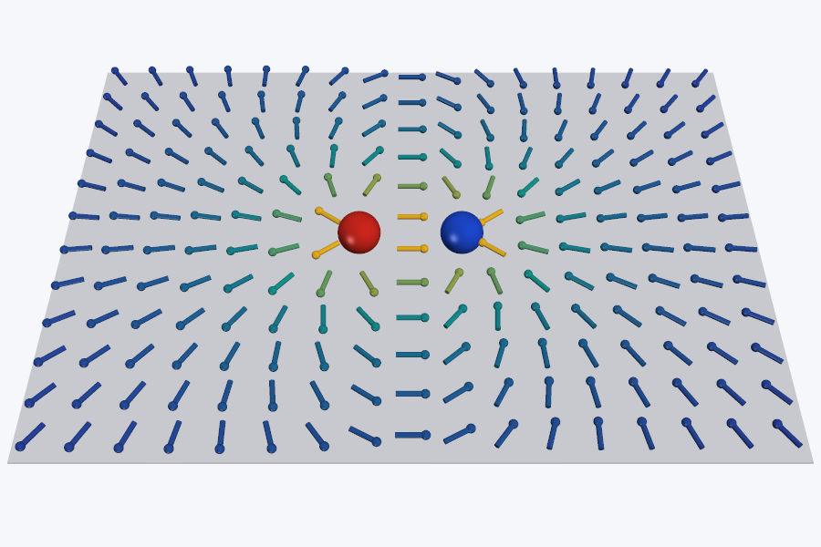 | 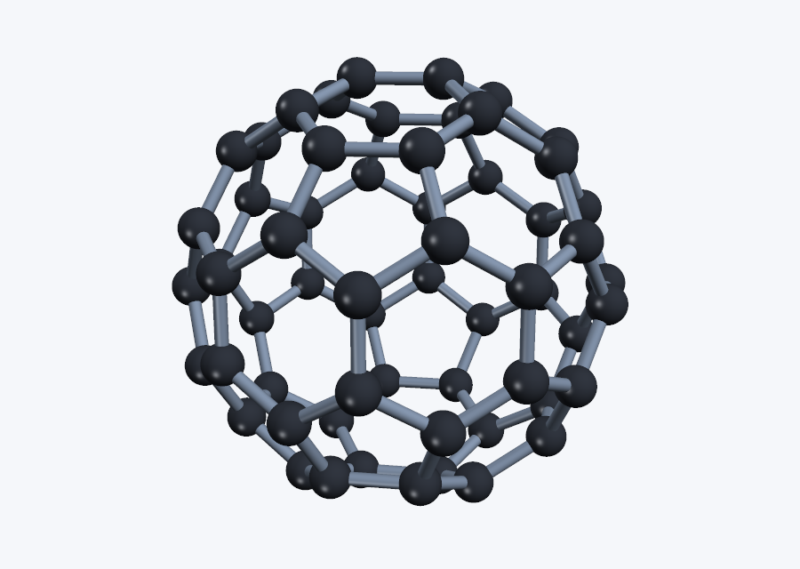 |
| Elenbaas sweep finds 8 fins (4.7 K/W) near the Bar-Cohen spacing<br>`lmctl autorun https://raw.githubusercontent.com/lmctl-ai/lmcad/main/examples/heat-sink.lms` | Coulomb sum on a grid; far field matches p/r³ within 0.4 %<br>`lmctl autorun https://raw.githubusercontent.com/lmctl-ai/lmcad/main/examples/dipole-field.lms` | 60 atoms from symmetry; 90 bonds pass Euler's V − E + F = 2<br>`lmctl autorun https://raw.githubusercontent.com/lmctl-ai/lmcad/main/examples/buckyball.lms` |

### Products

| How much does the mug hold? | Turned vase | 2 × 6 construction brick |
| --- | --- | --- |
| 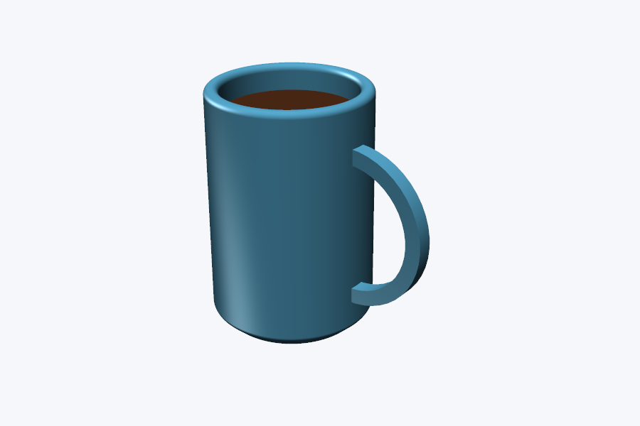 | 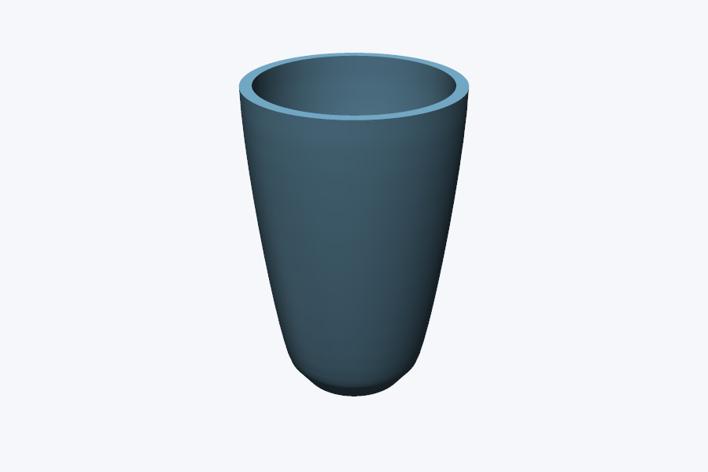 | 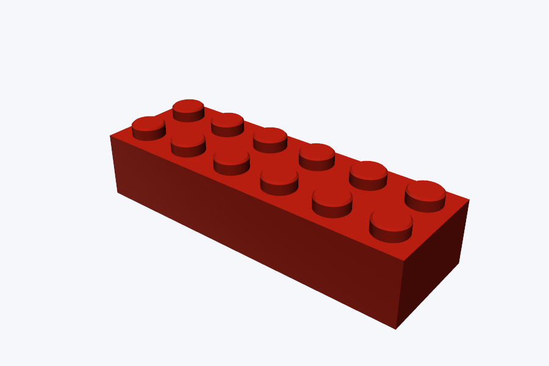 |
| Revolve, shell, fillet, fuse a handle: 629.5 mL from B-rep volumes<br>`lmctl autorun https://raw.githubusercontent.com/lmctl-ai/lmcad/main/examples/mug.lms` | Bezier profile revolved and shelled: 5.29 L capacity, ceramic volume asserted<br>`lmctl autorun https://raw.githubusercontent.com/lmctl-ai/lmcad/main/examples/vase.lms` | Shelled box plus 12 revolved studs: 2.68 g of ABS<br>`lmctl autorun https://raw.githubusercontent.com/lmctl-ai/lmcad/main/examples/brick.lms` |

Every picture is written by the example named in its caption. Paste the `lmctl autorun` line into a terminal in an empty directory: lmscript downloads the released `lmcad` (and `lmplot` for the three charts), runs the program, and leaves `images/<name>.png` (or `.gif`) there. Each example also asserts its own answer (a volume, a force, a count) on the host, so a wrong model fails instead of rendering. `examples/render-all.sh` regenerates `docs/images/`.

## Quick start (1 minute)

```sh
npm install -g @lmctl-ai/lmctl        # lmscript + lmctl (Node.js >= 24)
export GITHUB_TOKEN=$(gh auth token)  # optional: avoids GitHub API rate limits on first install
lmctl autorun https://raw.githubusercontent.com/lmctl-ai/lmcad/main/examples/gear-train.lms
```

A program is an ordinary lmscript file with a `_dsl_` block that names the host. The block is compiled against the schema the `lmcad` binary reports, saved as bytecode, and run by that binary:

```
out = ARGV.len() > 0 ? ARGV[0] : "build/box.dslb";
mkdir("images");
mkdir("build");
p = _dsl_ cli="lmcad" install="github:lmctl-ai/lmcad@latest";
let shape = scene.box(2.0, 3.0, 4.0, material().color(0.2, 0.55, 0.85));
scene.assert_close(shape.volume(), 24.0, 0.000001);
scene.fit_camera(42.0, 1.2);
scene.render_png("images/box.png", 640, 480);
end _dsl_
savedsl(p, out);
r = system(concat(dsl_cli(p), ["--dsl", out]), 600000);   # run with the same host; system() defaults to a 60 s limit
if (r.code != 0) { println(r.stderr + r.stdout); }
assert(r.code == 0);
println("wrote images/box.png");
```

`lmcad --dsl-schema` lists the whole API: primitives (box, sphere, cylinder, `tube_between`), sketches revolved or extruded into solids, booleans (`union`, `cut`, `intersect`), `fillet`/`chamfer`/`hollow`, B-rep `volume()` and bounds, lights, cameras, supersampling, PNG/PPM/APNG renders and STL/OBJ export. More basic examples (still life, STL export, range loop, keyframe tween, turntable, section view, water molecule) are listed in [examples/README.md](examples/README.md), each with its autorun line. Guides: [tool book](https://lmctl.com/tools/lmcad/) · [get started](https://lmctl.com/tools/lmcad/get_started.html) · [API guide](https://lmctl.com/tools/lmcad/guide.html) · [releases](https://github.com/lmctl-ai/lmcad/releases).

## Limits (honest)

- The renderer is a deterministic z-buffer rasteriser with diffuse plus Blinn-Phong shading: no shadows, reflections, transparency or text. Labels and charts come from a second host (the truss, beam and heat-sink figures use lmplot).
- Sketches are straight-segment polygons, so arcs and involutes are approximated by points; there is no sweep along a path, loft, cone or torus (the spring is built from short tubes).
- Host limits: sketch coordinates within ±500 units, part extent 1000, 2000 faces and 10,000 edges per shape, 1,000,000 triangles, 240 animation frames and 64 million total frame pixels. Model in mm, cm or m to stay inside them.
- Inside a `_dsl_` block the language has `let`, `if`, `for`/`range`, arithmetic and `sin cos sqrt pow abs floor min max clamp lerp ease`; there are no arrays, user functions or `atan`, and outer lmscript variables are not visible.
- Exchange formats are write-only STL/OBJ; STEP/IGES import and export are not built in.

## Build from source

### Build OpenCASCADE once

OCCT 8.0.1 is a native build dependency. On this aarch64 Linux setup, the clean static geometry build takes about 16 minutes and peaks around 386 MiB RSS. The configured set disables Draw, Visualization, ApplicationFramework and DataExchange; there is no X11, OpenGL, Tcl, FreeType or TBB dependency. The prefix is reused by lmcad and fresh clones.

```sh
OCCT_SRC="$PWD/build/occt-src" OCCT_BUILD="$PWD/build/occt-build" \
  OCCT_PREFIX="$PWD/build/occt-prefix" scripts/build-occt.sh
```

`TKOffset` is the one extra toolkit beyond the spike's 14-library closure; shelling needs it. The executable links the resulting 15 static OCCT archives, without OCCT's STL/STEP exchange modules. CI caches the installed prefix by OCCT version, the SHA-256 of `.github/occt-cmake-flags.txt`, runner architecture, and exact GCC version. The prefix is cached instead of the build tree. In Actions run 39264695761, the cold OCCT install took 34m24s on x64 and 20m58s on arm64 (three build jobs); runner performance varies. The warm run 39270104147 restored both prefixes and finished each complete Linux job in 76s (x64) / 74s (arm64), with OCCT compilation skipped.

### Build

Requirements: C++17 compiler, CMake 3.24+, Ninja, and (to compile examples) the published lmscript compiler, which requires Node.js >=24.15.0 and supports DSL v5/schema v2. CMake generates `schema_embedded.hpp` from the schema file; changing the schema triggers regeneration.

```sh
scripts/sync-sdk.sh --verify
cmake -S . -B build -G Ninja -DCMAKE_BUILD_TYPE=Release \
  -DLMCAD_OCCT_PREFIX="$PWD/build/occt-prefix" -DLMCAD_FULL_STATIC=ON
cmake --build build -j3
file build/lmcad
ldd build/lmcad  # prints: not a dynamic executable
stat -c '%s bytes' build/lmcad
```

The verified AArch64 release binary is 26,767,080 bytes (25.5 MiB). Set `LMCAD_OCCT_PREFIX` when using a different install location.

`test.sh` selects `lmscript` on `PATH` only when it accepts this schema and compiles a while-loop probe to v5 bytecode. Install the published compiler with `npm i -g @lmctl-ai/lmctl`, or set `LMSCRIPT_BIN` to an explicit v5 compiler executable. If neither is available, selection fails with an install hint. For local compiler-source development only, set `LMSCRIPT_SOURCE` to the compiler source directory and run `scripts/lmscript-source.sh`; this adapter handles standalone `_dsl_` blocks.

## CLI

```sh
build/lmcad --dsl-schema
build/lmcad --dsl-schema --json > /tmp/lmcad-schema.json
cmp schema/lmcad.dsl.json /tmp/lmcad-schema.json
build/lmcad --dsl-signatures
lmscript --dsl-signatures schema/lmcad.dsl.json
PATH="$PWD/build:$PATH" lmscript examples/still-life.lms   # cli="lmcad" resolves to the build
build/lmcad --dsl build/still-life.dslb                      # rerun the saved bytecode
```

`--version` prints `lmcad X.Y.Z` (the CMake project version; a release tag must be `vX.Y.Z`, which CI checks, because lmscript `install="github:lmctl-ai/lmcad@latest"` compares the two). `--dsl-schema` prints a compact registry-derived summary with context first, then free functions and members grouped by type. `--dsl-schema --json` prints the embedded schema bytes exactly. `--dsl-signatures` prints the host registry's canonical signature list, which must match the compiler's output for the schema. `--dsl FILE [FILE ...]` executes bytecode files in argument order, using one embedded schema and the same host context for every block. Each file has fresh VM locals, while shapes, materials, camera and other host state persist across files. Execution stops on the first load or runtime error (exit 3); previous outputs and any output already written by the failing block remain. Each completed block prints one success JSON line, followed by an error JSON line if a later block fails. All command-line arguments are validated before execution (invalid syntax exits 2). The old `--dsl-schema FILE` input form is removed.

`scene.animation(path, w, h, fps)` writes APNG; the gear-train and turntable examples convert theirs to GIF with ffmpeg. PNG and APNG use deterministic LZ77/fixed-Huffman DEFLATE (stored blocks for incompressible data). APNG uses exact rational frame delays (integer FPS from 1 through 240) and loops forever; `lmcad-apng-extract` extracts a zero-based full frame to PNG. Host limits are 240 frames, 64 million total frame pixels, and 16,777,216 pixels per frame. Frames stream to a temporary file in the destination directory; memory does not grow with frame count. `finish()` atomically replaces the destination. Omitting it discards the temporary animation when the host exits; an empty finish, second finish, or add after finish is an error. Write failures preserve the previous destination and remove temporary output. Frame-count and cumulative-pixel checks precede rendering; the renderer also checks the supersampled dimensions and pixel count before allocating. A 36-frame 1920x1080 animation exceeds the cumulative limit (74,649,600 pixels); at that resolution at most 30 frames fit, with supersampling at most 2. `fit_camera(fov, margin)` snapshots visible bounds and adapts the fitted distance to each render’s aspect ratio; FOV is vertical and margin must be at least 1. Explicit camera `look_at` or `clipping` calls disable automatic fitting. Ambient must be finite and nonnegative; values above 1 clamp to full ambient illumination. Scene settings provide key and fill lights, ambient level, and bounded 1..8 supersampling (default 2). OCCT tessellation uses analytic surface normals, blends them across nearly tangent face seams, and keeps sharper B-rep creases crisp. The default mesh uses 0.05 linear deflection and 0.1-radian angular deflection. Materials support bounded Blinn-Phong highlights through `specular(strength)` and `shininess(power)`; key and fill directions are tuned for stronger face contrast. Boolean operations and solid-volume assertions use the BRep geometry.

`scene.tube_between(x1, y1, z1, x2, y2, z2, radius, material)` creates a solid cylindrical segment between two 3D endpoints. It is useful for molecule bonds, rigid-body links, and trajectory tubes without requiring callers to calculate rotations.

## Test

```sh
./test.sh
cmake -S . -B build-sanitize -G Ninja -DCMAKE_BUILD_TYPE=Release \
  -DCMAKE_CXX_FLAGS='-fsanitize=address,undefined -fno-omit-frame-pointer -O1' \
  -DCMAKE_EXE_LINKER_FLAGS='-fsanitize=address,undefined' \
  -DLMCAD_OCCT_PREFIX="$PWD/build/occt-prefix" -DLMCAD_FULL_STATIC=OFF
LMCAD_FULL_STATIC=OFF BUILD_DIR=build-sanitize ./test.sh
```

The test script checks SDK pinning, that every example self-executes against the built host (lmplot examples are skipped with a message when lmplot is unavailable), that every README autorun target and gallery image exists and is a valid PNG/GIF, JSON schema byte identity, complete summary/signature consistency, sequential multi-file execution, PNG contents and determinism, bounded supersampling, STL topology/volume, CAD exports and assertions, APNG chunk order/CRCs/sequences/delays/frame counts, extracted-frame identity, changed frames, and host-side validation refusals. The SDK loader rejects every bytecode version except v5. See [`durable-memory/03-build-run-test.md`](durable-memory/03-build-run-test.md), [`durable-memory/04-gotchas.md`](durable-memory/04-gotchas.md), and [`durable-memory/05-open-items.md`](durable-memory/05-open-items.md).

Linux CI builds static OCCT once per runner architecture/toolchain cache key, then builds the fully static host and runs `test.sh`. The verified cold run produced 30,116,488-byte x64 and 26,767,080-byte arm64 executables; warm jobs passed all CI checks and `ldd` reported `not a dynamic executable`. The prefix caches were 27.47 MiB (x64) and 27.77 MiB (arm64). On `v*` tags it attaches `lmcad-linux-x64`, `lmcad-linux-arm64`, the license/notice files, and an OCCT relinking-recipe archive. macOS (arm64 via macos-15, x64 via macos-15-intel) and Windows (MinGW-w64) jobs are enabled: macOS links OCCT statically with AppleClang and asserts `otool -L` shows only system libraries; Windows produces a standalone `lmcad.exe` (only system DLLs). See [`durable-memory/13-licensing.md`](durable-memory/13-licensing.md) and [`durable-memory/14-ci-macos-windows.md`](durable-memory/14-ci-macos-windows.md) before redistributing binaries.

Supersampling uses an n×n box filter over all subpixels, decoding sRGB bytes to linear light for averaging and encoding the result back to sRGB. Output dimensions stay unchanged, including odd sizes. Both raster dimensions after multiplication by n must be at most 8192, with at most 16,777,216 high-resolution pixels; this bounds the RGB/depth buffers before allocation. The renderer uses a diffuse plus Blinn-Phong display-colour model; it is not physically based.

## License

lmcad-authored code is licensed under the MIT License; see [`LICENSE`](LICENSE).
This also covers the vendored `cpp/dslvm.hpp`. OCCT and copied Python reference
examples retain their separate licenses and notices listed in
[`THIRD_PARTY_NOTICES.md`](THIRD_PARTY_NOTICES.md). Every Linux release artifact
includes `LICENSE`, `THIRD_PARTY_NOTICES`, the relevant full license texts, and
OCCT relinking instructions and object files. The npm package layouts declare MIT and `private: true`; the workflow does not
publish them.

Made by **Lattice Systems LLC**.
